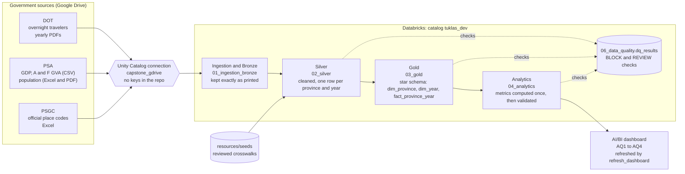

# ProvInsights

[](https://github.com/ftw-git-away/provinsights-ph-tourism/actions/workflows/ci.yml)
[](https://github.com/ftw-git-away/provinsights-ph-tourism/actions/workflows/deploy.yml)

ProvInsights is GitAway's FTW Batch 12 LT3 capstone. It brings together Department of Tourism (DOT), Philippine Statistics Authority (PSA), and Philippine Standard Geographic Code (PSGC) data in one Databricks pipeline, so planners can see where tourism is concentrated, how provinces compare in visitors and tourism-related output per visitor, and which provinces beyond the leading destinations warrant closer attention.

## Start here

| To... | Read |
| --- | --- |
| Understand the question and definitions | [Business and analytical questions](docs/business-and-analytical-questions.md) |
| See how the system is built and why | [Architecture](docs/architecture.md) |
| Set up, run, check and fix the pipeline | [Runbook](docs/runbook.md) |
| Hand off the project or set it up in a new workspace | [Runbook, section 0](docs/runbook.md#0-hand-off-set-up-in-a-new-workspace) |
| Look up tables and columns | [Data dictionary](docs/data-dictionary.md), [Schema and source-to-target mapping](docs/schema-and-source-to-target-mapping.md) |
| See the checks and the latest results | [Data-quality rules](docs/data-quality-rules.md), [Analytics run evidence](docs/analytics-run-evidence.md), [Dashboard evidence](docs/dashboard-evidence.md) |
| Understand past choices | [Decision log](docs/project-decision-log.md) |
| Contribute | [Team workflow](#team-workflow) |

## Problem

**Tourism is one of the country's biggest industries, but its benefits are concentrated in a few places.** In 2023, tourism employed 6.21 million Filipinos and made up 8.6% of GDP (PSA, Philippine Tourism Satellite Account). Yet in 2017, Boracay, an island of only about 10 km², hosted one in three visitors to the country, and in 2018 it had to close for six months to recover from overcrowding and pollution. The pattern continues: in 2023, the 10 leading destinations received **43.7%** of all overnight travelers, while many provinces with beaches, mountains and culture received far fewer.

<p align="center">
  
  <br />
  <sub>Boracay, Aklan. Photo: <a href="https://www.rappler.com/culture-desk/travel/boracay-included-world-greatest-places-2022-time-magazine">Rappler</a>.</sub>
</p>

**The DOT has made spreading tourism a national goal.** Its [National Tourism Development Plan (NTDP) 2023-2028](https://www.visitcentralluzon.com/wp-content/uploads/2026/02/DOT-NTDP-23-00043-Department-of-Tourism-National-Tourism-Development-Plan-2023-2028.pdf) sets **Goal 4: Equalization of tourism product development and promotion**, which aims to create opportunities for emerging provinces (Objective 4.1) and link them with key destinations through circuits and joint promotion (Objective 4.2). The plan also calls for product mapping across all regions and provinces (Objective 4.3) and for better tourism data and monitoring (Objectives 2.2 and 4.5).

**But the evidence planners need is scattered.** To act on Goal 4, planners need to know which provinces are left behind, what gap each one shows, and where closer attention is warranted. Visitor counts come from DOT as yearly PDFs, economic and population data come from PSA in different spreadsheet formats, and official place codes come from PSGC. The sources cover different years and do not name places the same way.

**ProvInsights brings them together.** One Databricks pipeline connects tourism, population and economic data for every province, and a dashboard turns it into a province-by-province view: where the gaps are and which provinces warrant closer attention. It shows where to look. It does not prescribe interventions, investments or lead agencies (DL-037).

**Who it is for:** DOT and its regional offices (national planning), provincial and city tourism offices (local planning), DTI (local businesses), and development planners (NEDA/DEPDev).

## Key terms

| Term | Definition |
| --- | --- |
| **Overnight travelers (visitors)** | Travelers reported by DOT as staying overnight in accommodation establishments. The figure counts stays, not unique persons, and excludes day-trippers. |
| **Tourism activity** | The number of overnight travelers recorded in a province in a given year. |
| **Tourism intensity** | Overnight travelers per 1,000 residents. |
| **Leading destinations** | The 10 provinces with the highest average annual overnight travelers across the years with reported data in 2019-2023 (DL-032). |
| **Tourism-related output** | Accommodation and food services (A&F) gross value added at current prices, used as a proxy for tourism-related economic activity (DL-007). |
| **Output per visitor** | A&F gross value added divided by overnight travelers for 2023, in PHP. A&F GVA is published in thousand PHP and multiplied by 1,000 before division (DL-033). |
| **Lower-income** | A 2023 GDP per capita (current prices) below the median of all reporting units that have a 2023 value. An income indicator, not a poverty measure (DL-035). |
| **Tourism share of the economy** | A&F gross value added divided by GDP, both at current prices, multiplied by 100, for 2023. Shown for context; it does not decide a province's group or order. |
| **Small base** | A province with fewer than 10,000 overnight travelers in 2023. Its output per visitor may be inflated by the small denominator, so it is marked "Check before naming" (DL-036). |

**Tourism activity means reported overnight travelers.** It is not a count of unique people or all visitors. **A&F (hotels and restaurants) is a proxy for tourism's economic output**, because PSA publishes tourism's value added only at the national level. It also includes spending by residents and business travelers, so it describes tourism-related patterns, not exact tourist spending. Findings support further study, not causal or investment-return claims (DL-008). A missing value is never treated as zero (DL-009).

## Business question

> **How can tourism and economic data across Philippine provinces be analysed to identify destinations that may warrant greater attention for tourism development?**

- **Greater attention** means a province shows a gap in the data (few visitors, low output per visitor, or both) that justifies further study. It is not a recommendation to invest.
- **Equalized tourism development** is the NTDP's Goal 4: opening more of the Philippines to tourism and supporting destinations beyond the established ones. The NTDP describes it as a direction, not a numeric target. ProvInsights supports it by showing where tourism is concentrated (AQ1) and which provinces warrant closer attention (AQ2 to AQ4).
- **Reporting units.** The analysis covers 100 reporting units: 82 provinces, 16 highly urbanized cities (HUCs) that DOT reports separately, the City of Isabela and the National Capital Region (DL-010). All are called "provinces" here.

## Analytical questions

The canonical questions, definitions and rules are in [docs/business-and-analytical-questions.md](docs/business-and-analytical-questions.md) and DL-031 in the [decision log](docs/project-decision-log.md).

| Analytical question | Purpose | NTDP link | Analytics tables |
| --- | --- | --- | --- |
| **AQ1:** Which provinces have the highest and lowest tourism activity, and how is it distributed across provinces? | Shows how unevenly tourism is distributed, how much is concentrated in the leading destinations, and which provinces record the fewest visitors | Goal 4; Obj. 2.2 | `tourism_activity`, `tourism_concentration` |
| **AQ2:** How do provinces compare on both the number of visitors and the tourism-related output per visitor? | Examines whether provinces with similar visitor numbers generate similar output per visitor | Obj. 4.1 | `tourism_economy` |
| **AQ3:** Is high tourism-related output per visitor found only in higher-income provinces? | Tests whether the AQ2 pattern goes beyond income | Goal 4 | `tourism_economy` |
| **AQ4:** Which provinces beyond the top 10 destinations warrant closer attention, and what does the data show for each? | A named list of provinces, each with the gap indicated by the data | Obj. 4.1, 4.2 | `tourism_economy`, `tourism_activity` |

The questions build the answer in order: **find the gap** (AQ1), **compare** output per visitor (AQ2), **check** whether the pattern is explained by income (AQ3), then **identify** where closer attention is warranted (AQ4).

The trend period is **2019-2023**, with 2020 and 2021 identified as COVID-19 years. AQ2 to AQ4 use **2023**, the latest year with both DOT and PSA provincial data.

## Province groups

Each province is placed against the 2023 medians of visitors (279,150) and output per visitor (PHP 8,652), taken across all provinces with both values. At or above the median counts as high (DL-034).

| Group | Visitors | Output per visitor | Gap the data shows | What to look at |
| --- | --- | --- | --- | --- |
| **Established** | High | High | None on these two measures | Do the benefits reach nearby provinces? |
| **Busy but low-output** | High | Low | Output per visitor | Where does visitor spending go? |
| **Small but high-output** | Low | High | Visitor numbers | What keeps visitor numbers low? |
| **Limited activity** | Low | Low | Both | How does tourism compare with other sectors here? |

The AQ4 list covers every province beyond the leading destinations that has a group (83 in 2023). It is ordered by the gap the data shows (Busy but low-output, then Small but high-output, then Limited activity, then Established, which shows no gap on these two measures), then lower-income provinces first, then by visitors, highest first (DL-037). Small-base provinces stay in the list, marked "Check before naming" (DL-036).

The groups describe positions relative to other provinces. They are not national benchmarks, and they do not say what a province needs or which agency should act.

## Data sources

| Source | Role |
| --- | --- |
| DOT Regional Distribution of Overnight Travelers (2019-2024) | Provincial tourism activity |
| PSA population projections | Population denominators for tourism intensity |
| PSA provincial GDP, GDP per capita, and accommodation and food services GVA | Output per visitor, the lower-income flag and tourism share of the economy |
| PSA PSGC | Official place codes and the crosswalk that makes all sources agree on what a place means |

See [Source assessment](docs/consolidated-data-sources.md) for identifiers and limitations.

## How the pipeline works



The Databricks job [`tourism_pipeline`](resources/jobs/tourism_pipeline.yml) runs every layer in order and ends by refreshing the dashboard. A BLOCK failure stops the run, so later layers and the dashboard refresh never build on failed data, and a failure email goes to `alert_email`.

- **Source access:** the DOT, PSA and PSGC files sit in shared Google Drive folders. The ingestion notebooks read them directly through the Unity Catalog connection `capstone_gdrive`, listing each folder with `list_files(..., connection => 'capstone_gdrive')`. The connection holds the Google Drive credentials, so no service-account keys, tokens or passwords are stored in the notebooks or the repository, and access is controlled by who can use the connection in Unity Catalog. Each original file is also stored as binary in Bronze with a SHA-256 fingerprint (`_source_sha256`). The DOT and DS_18 PDF notebooks compare it with the previous load and flag a replaced or edited file in `01_ingestion.file_manifest`; for the other sources the fingerprint is stored but not compared. Folder links and file IDs are in the [Bronze ingestion guide](docs/bronze-ingestion-guide.md).
- **Bronze** keeps every source value exactly as printed, with its file, page and row, so any number can be traced back to the original document.
- **Silver** cleans each source and maps every place to a PSGC reporting unit using the reviewed crosswalks in `resources/seeds/`. Each Silver notebook runs its own data-quality checks and fails on a BLOCK error.
- **Gold** is a star schema: `dim_province`, `dim_year` and `fact_province_year` (see [schema and source-to-target mapping](docs/schema-and-source-to-target-mapping.md)).
- **Analytics** calculates the base metrics once, in `tuklas_dev.05_analytics`. The 2023 province profile used by AQ2 to AQ4 (leading destinations, output per visitor, medians, groups, lower-income and small-base flags) is computed from those tables in the dashboard dataset `ds_profile` (`dashboard/datasets/05_profile_2023.sql`). Every row carries the Analytics run ID and the exact Gold Delta versions it was built from. `tourism_recovery` and `traveler_segment_recovery` are also built as supporting tables, but they are not used to answer the business question.
- **Data quality:** check results are saved in `06_data_quality.dq_results`, and each layer records its runs in a run log (`silver_run_log`, `gold_run_log`, `05_analytics.analytics_run_log`). A BLOCK check protects correctness. A REVIEW check flags something unusual that needs a person to look. Rules are in [data-quality rules](docs/data-quality-rules.md).

Every table and column is described in the [data dictionary](docs/data-dictionary.md). Architecture, design decisions and limitations: [docs/architecture.md](docs/architecture.md). How to run, check and fix the pipeline: [docs/runbook.md](docs/runbook.md). Run evidence: [Gold](docs/gold-run-evidence.md) and [Analytics](docs/analytics-run-evidence.md). Task order, settings and how to add a task are in [`resources/README.md`](resources/README.md).

## Repository guide

```text
.github/
  PULL_REQUEST_TEMPLATE.md
  workflows/                      # ci.yml (validate + unit tests), deploy.yml (deploy bundle)
docs/
  README.md                       # index of every document
  business-and-analytical-questions.md   # business question, AQ1-AQ4, definitions, province groups
  project-decision-log.md         # approved decisions (DL-001 onwards)
  architecture.md                 # architecture, design decisions, limitations
  architecture.png                # architecture diagram
  runbook.md                      # how to run, check and fix the pipeline
  consolidated-data-sources.md    # sources, identifiers and limitations
  bronze-ingestion-guide.md       # Google Drive folders, file IDs, ingestion control tables
  data-dictionary.md              # every Gold, Analytics and dashboard column
  schema-and-source-to-target-mapping.md # Gold star schema and column mappings
  data-quality-rules.md           # BLOCK / REVIEW policy and every check ID
  gold-run-evidence.md            # latest Gold run results
  analytics-run-evidence.md       # latest Analytics run results
  dashboard-evidence.md           # dashboard pages checked against the Analytics tables
  images/dashboard/               # dashboard screenshots
notebooks/
  01_ingestion_bronze/            # sources to Bronze, via the capstone_gdrive connection
  02_silver/                      # cleaning and PSGC mapping, with DQ checks
  03_gold/                        # star schema, with DQ checks and run evidence
  04_analytics/                   # build, validation, run evidence
  99_maintenance/                 # one-off maintenance, run by hand (not in the job)
resources/
  jobs/tourism_pipeline.yml       # end-to-end Databricks job, ends with the dashboard refresh
  seeds/                          # reviewed crosswalk and coordinate files
databricks.yml                    # Databricks bundle (alert_email, dashboard_id, warehouse_id)
tests/
  README.md                       # what is tested and where
  unit/                           # unit tests run in CI: job, notebooks, SQL, seeds, docs
  requirements.txt                # pinned test dependencies
dashboard/
  README.md                       # opening, refreshing and editing the shared dashboard
  provinsights.lvdash.json        # exported dashboard definition (versioned copy)
  datasets/                       # SQL for each dashboard dataset
  tools/build_lvdash.py           # syncs datasets/ into the JSON; --check fails on drift
```

## Dashboard

The shared Databricks AI/BI dashboard (PROVINSIGHTS DASHBOARD) answers one analytical question per page. The pipeline refreshes it at the end of every run. Opening, refreshing and editing it are covered in [`dashboard/README.md`](dashboard/README.md), and each page is checked against the Analytics tables in [dashboard evidence](docs/dashboard-evidence.md).

| Page | Answers |
| --- | --- |
| Start here | The business question and which page answers which AQ |
| 1. Where visitors go | AQ1: highest and lowest tourism activity, and the share going to the leading destinations |
| 2. Visitors and output per visitor | AQ2: the four province groups |
| 3. Output and income | AQ3: whether high output per visitor is found only in higher-income provinces |
| 4. Provinces to watch | AQ4: provinces beyond the leading destinations that warrant closer attention |
| Definitions | Key terms, data notes, out of scope and lineage |

Appendix pages A and B show tourism and traveler recovery as reference only. They do not answer an AQ.

## Databricks deployment

The pipeline is deployed to Databricks as a bundle defined in [`databricks.yml`](databricks.yml). It uses three variables: `alert_email` (receives failure emails, supplied by GitHub), and `warehouse_id` and `dashboard_id` (SQL warehouse and shared dashboard for the refresh task, with defaults in `databricks.yml`). No workspace URL or token is stored in the repository. GitHub Actions supplies them from the GitHub environments (see [`.github/workflows/README.md`](.github/workflows/README.md)). 

**How changes reach Databricks**

1. Open a pull request. CI runs **Validate repository** and **Validate Databricks bundle**.
2. After approval, merge into `main`.
3. The **CD - Deploy ProvInsights PH to Databricks** workflow validates and deploys the bundle. Deploying updates the job but does not run it.

**Working with the bundle locally**

```bash
# sign in once
databricks auth login --host <workspace URL> --profile <profile>

# check the bundle (run before every pull request)
databricks bundle validate -t dev -p <profile> --var="alert_email=<your email>"

# deploy to your own dev folder
databricks bundle deploy -t dev -p <profile> --var="alert_email=<your email>"

# run the pipeline (writes to the shared tuklas_dev catalog; tell the team first)
databricks bundle run -t dev -p <profile> tourism_pipeline --var="alert_email=<your email>"
```

## Team workflow

1. Link work to an issue and state its acceptance criteria.
2. Make a focused change on a branch.
3. Open a PR using the [PR template](.github/PULL_REQUEST_TEMPLATE.md), explaining behavior, source or schema changes, and validation evidence.
4. Request a teammate review and address findings before merging.
5. Update relevant documentation when implementation or decisions change.

Use the [Decision log](docs/project-decision-log.md) for approved choices. Preserve original source artifacts and keep credentials out of Git.

CI runs on pull requests to `main` and on pushes to `main` and to `feature/`, `chore/`, `docs/`, `fix/`, `test/` and `ci/` branches. **Validate repository** checks the required folders and runs the unit tests in [`tests/unit/`](tests/unit/) (job definition and task order, notebook structure, Python and SQL syntax, seeds, and alignment of the Silver, Gold and Analytics check IDs with the rules doc). **Validate Databricks bundle** runs `databricks bundle validate`. Both checks are required, so a pull request cannot be merged until they pass and the branch is up to date with `main`. CI does not run the notebooks or read source data; data quality is checked inside the pipeline (see [`tests/README.md`](tests/README.md)).

## Team GitAway

**GitAway, FTW Batch 12 LT3:** Cole, Nella (lead), Cha, Gab, and Haze.
