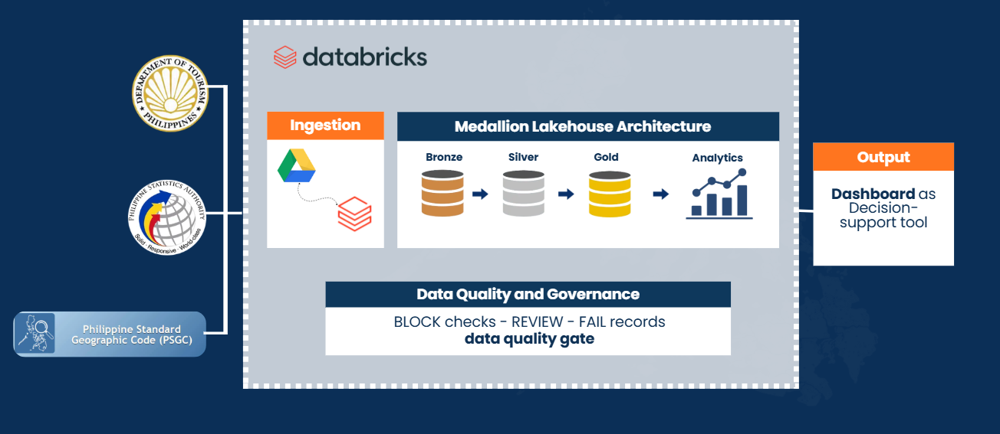
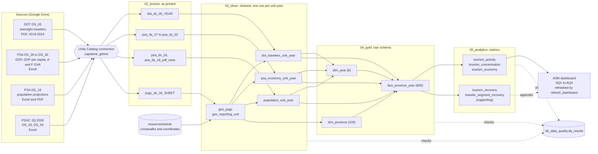
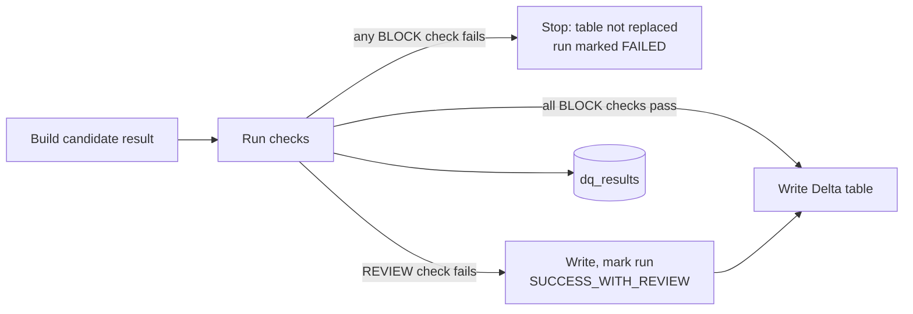
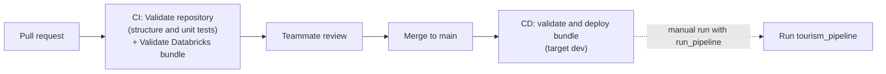

# ProvInsights Architecture

This document explains how ProvInsights turns government source files into a province-level dashboard: the components, how data flows between them, where quality is enforced, and why the main design choices were made.

For the business questions see [business-and-analytical-questions.md](business-and-analytical-questions.md). For every table and column see the [data dictionary](data-dictionary.md), and for how Gold columns are mapped from the sources see [schema-and-source-to-target-mapping.md](schema-and-source-to-target-mapping.md). For how to run the pipeline see [runbook.md](runbook.md).

## Contents

1. [Purpose and users](#1-purpose-and-users)
2. [Architecture overview](#2-architecture-overview)
3. [Detailed data flow](#3-detailed-data-flow)
4. [Components by layer](#4-components-by-layer)
5. [Data quality and governance](#5-data-quality-and-governance)
6. [Orchestration and deployment](#6-orchestration-and-deployment)
7. [Key design decisions](#7-key-design-decisions)
8. [Lineage, reruns and reproducibility](#8-lineage-reruns-and-reproducibility)
9. [Limitations and known gaps](#9-limitations-and-known-gaps)

---

## 1. Purpose and users

**Problem.** Tourism in the Philippines is concentrated in a few leading destinations. ProvInsights answers: *How can tourism and economic data across Philippine provinces be analysed to identify destinations that may warrant greater attention for tourism development?* (DL-031). Answering it needs three government sources that use different place names, different years and different formats (PDF and Excel). None of them can be compared directly.

**What the architecture provides.** One trusted table per province and year that joins tourism, economy and population on a single geographic key, metrics computed once from that table, and a dashboard that shows where to look closer. Every number can be traced back to the source file and row it came from. The dashboard shows what the data says and does not prescribe interventions (DL-037).

**Users.**

| User | Uses |
| --- | --- |
| Tourism planners (non-technical) | The dashboard |
| Data team (GitAway) | Notebooks, job, data-quality results, run logs |
| Reviewers and future maintainers | This document, the decision log, run evidence |

## 2. Architecture overview



Everything runs on **Databricks** with **Unity Catalog** and **Delta Lake**, in the catalog `tuklas_dev`. Each layer has its own notebook folder and schema. The schema numbers did not change when the notebook folders were renamed.

| Notebook folder | Schema | Layer | Holds |
| --- | --- | --- | --- |
| `01_ingestion_bronze` | `01_ingestion` | Ingestion control | `ingestion_run_log`, `file_manifest`, `ingestion_errors` |
| `01_ingestion_bronze` | `02_bronze` | Bronze | Source tables kept exactly as printed, plus the original files as binary |
| `02_silver` | `03_silver` | Silver | Cleaned, typed tables mapped to reporting units; `silver_run_log` |
| `03_gold` | `04_gold` | Gold | Star schema: `dim_province`, `dim_year`, `fact_province_year`; `gold_run_log` |
| `04_analytics` | `05_analytics` | Analytics (serving) | Five metric tables; `analytics_run_log` |
| all of the above | `06_data_quality` | Governance | `dq_results`: one row per check per run, across all layers |
| `99_maintenance` | none | Maintenance | One-off notebooks run by hand, not part of the job |

| Component | Technology |
| --- | --- |
| Source storage | Google Drive, read through the Unity Catalog connection `capstone_gdrive` (no keys in the repository) |
| Processing | Databricks notebooks (PySpark and SQL) |
| Storage | Delta tables in Unity Catalog |
| Reference data | Reviewed seed CSVs in [`resources/seeds/`](../resources/seeds/) |
| Orchestration | Databricks job `tourism_pipeline`, defined in a Databricks Asset Bundle |
| CI/CD | GitHub Actions: unit tests and bundle validation on pull request, deploy on merge |
| Serving | Shared Databricks AI/BI dashboard on `05_analytics`, refreshed by the job's last task |

## 3. Detailed data flow



**Grain at each step.** Bronze keeps one row per printed source row. Silver reduces each source to one row per **reporting unit and year**. Gold joins the three sources at that same grain: 100 units × 6 years (2019-2024) = 600 rows. Analytics computes metrics at the grain each question needs (unit-year, year, or unit). The dashboard's dataset queries then derive the 2023 province profile (leading destinations, output per visitor, medians and groups) from the Analytics tables.

## 4. Components by layer

### 4.1 Sources

| Source | Dataset | Format | Used for |
| --- | --- | --- | --- |
| DOT Regional Distribution of Overnight Travelers | DS_05, 2019-2024 | PDF, one per year | Tourism activity; recovery and traveler segments (supporting) |
| PSA Provincial Accounts | DS_27 to DS_32 (DS_26 for reconciliation) | Excel | GDP, GDP per capita, A&F GVA (current and constant 2018 prices) |
| PSA Projected Mid-Year Population | DS_18 | Excel and PDF | Population denominator for tourism intensity |
| PSA Philippine Standard Geographic Code | DS_33, DS_34 (2Q 2026) | Excel | The geographic key shared by every table |

Source identifiers, coverage and limitations are in [consolidated-data-sources.md](consolidated-data-sources.md).

### 4.2 Ingestion and Bronze (`notebooks/01_ingestion_bronze`)

- `00_ingestion_setup` creates the control tables. It only uses `CREATE ... IF NOT EXISTS`.
- One notebook per source (`01_ingest_psa`, `02_ingest_psgc`, `03_ingest_dot`, `04_ingest_psa_ds18_pdf`) lists its Google Drive folder through the `capstone_gdrive` connection and writes Bronze tables. The connection holds the credentials, so no keys or tokens are stored in the notebooks or the repository.
- **Values are kept as text, exactly as printed.** No cleaning, mapping, deduplication or type conversion happens in Bronze.
- Every row keeps its position in the source (`source_row_number`, or `page_number` and `pdf_line_number` for PDFs) and carries `_run_id` and a source fingerprint (`_source_sha256`), so a changed file is detected (DL-023).
- The original PDF and Excel files are stored as binary (for example `dot_ds_05_pdf`, `psgc_source_files`), so the exact input can be re-read later.
- Titles, footnotes and "as of" notes go into `*_report_text` tables instead of being discarded.
- Each run is logged in `ingestion_run_log`, each file in `file_manifest`, and each failure in `ingestion_errors`.

Details: [bronze-ingestion-guide.md](bronze-ingestion-guide.md).

### 4.3 Silver (`notebooks/02_silver`)

Silver turns each source into clean, typed values for a common set of **100 reporting units** (DL-010).

| Notebook | Main outputs | What it does |
| --- | --- | --- |
| `01_silver_geography` | `geo_psgc`, `geo_reporting_unit`, `map_dot_area_to_psgc` | Builds the geography backbone from PSGC and the reviewed crosswalk seed. Region always comes from the PSGC code (DL-003). |
| `02_silver_dot` | `dot_travelers_unit_year`, `dot_travelers_row`, `dot_excluded_rows` | Maps every DOT label to a unit, applies row roles (add to parent, exclude), interprets `-` (DL-019), sets `traveler_value_status` and `comparable_to_2019` (DL-020). |
| `03_silver_psa_economy` | `psa_economy_unit_year`, `psa_economy_row`, `ref_indicator` | Matches PSA rows by cleaned name, adds Lucena into Quezon (DL-011), fills a single missing row from its region total (DL-024), records each measure's unit and price basis. |
| `04_silver_population` | `population_unit_year`, `population_row` | Combines DS_18 Excel and PDF to separate the 16 HUCs from their provinces (DL-021). |

Each notebook keeps a `*_row` table with one row per source value used, so every unit-year total can be traced back to the Bronze rows that made it. Rows that are deliberately left out are kept in an exceptions table, not dropped silently.

### 4.4 Gold (`notebooks/03_gold`)

Gold is a **star schema** that brings the three sources together.

| Table | Grain | Key | Built from |
| --- | --- | --- | --- |
| `dim_province` | Reporting unit (100) | `province_psgc` | `geo_reporting_unit`, `geo_psgc`, coordinates seed |
| `dim_year` | Year (2019-2024) | `year` | Silver coverage; flags the baseline year, recovery years and comparison window |
| `fact_province_year` | Unit × year (600) | (`province_psgc`, `year`) | `dot_travelers_unit_year`, `psa_economy_unit_year`, `population_unit_year` |

Gold copies values from Silver without recomputing them. A year a source doesn't cover is NULL, never 0 (DL-009). Caveat flags (`traveler_value_status`, `comparable_to_2019`, `foreign_includes_overseas_filipinos`, `derived_values`, `per_capita_recomputed`) are carried into the fact table so downstream layers keep them. Units of measure are stored as column comments from `ref_indicator`.

### 4.5 Analytics (`notebooks/04_analytics`)

`01_build_analytics` computes the metrics **once**, from Gold, into five tables in `05_analytics`.

| Table | Grain | Role |
| --- | --- | --- |
| `tourism_activity` | Unit × year | AQ1: volume, intensity per 1,000 residents, rank, share. Also the 2019-2023 average used to pick the leading destinations (DL-032). |
| `tourism_concentration` | Year | AQ1: top-5 and top-10 share of travelers |
| `tourism_economy` | Unit | AQ2 to AQ4: 2023 travelers, A&F GVA, A&F share of GDP and GDP per capita, the inputs for output per visitor, income and the province groups |
| `tourism_recovery` | Unit × comparison year | Supporting context: recovery index against 2019 (DL-028, DL-029) |
| `traveler_segment_recovery` | Unit (2023 below-2019 cohort) | Supporting context: domestic, foreign and overseas Filipino recovery |

The notebook builds each table in a temporary view, runs its blocking checks, and only then replaces the persisted table. `02_analytics_validation` then re-checks the persisted tables independently: it recomputes every derived metric from its inputs and reconciles base values to Gold at the exact Gold versions recorded on each row. `03_analytics_run_evidence` compares selected values against figures calculated straight from the source files.

Formulas and eligibility rules are in [schema-and-source-to-target-mapping.md section 4.4](schema-and-source-to-target-mapping.md#44-calculations-in-05_analytics).

### 4.6 Serving: dashboard

The shared Databricks AI/BI dashboard (PROVINSIGHTS DASHBOARD) reads **only** the `05_analytics` tables. Its dataset queries derive the 2023 province profile from them: the leading destinations (DL-032), output per visitor (DL-033), the medians and the four province groups (DL-034), the lower-income flag (DL-035) and the small-base flag (DL-036). The same queries feed pages 2 to 4, so every page uses one definition.

| Page | Answers |
| --- | --- |
| Start here | The business question and which page answers which AQ |
| 1. Where visitors go | AQ1 |
| 2. Visitors and output per visitor | AQ2: the four province groups |
| 3. Output and income | AQ3 |
| 4. Provinces to watch | AQ4: provinces beyond the leading destinations, with what the data shows and what to look at |
| Definitions | Terms, data notes, out of scope and lineage |
| Appendix A and B | Recovery tables, reference only |

The job's last task, `refresh_dashboard`, refreshes the dashboard after the Analytics run evidence, so it always shows the latest validated data. Opening, refreshing and editing it are covered in [dashboard/README.md](../dashboard/README.md). Screenshots checked against the Analytics tables are in [dashboard-evidence.md](dashboard-evidence.md).

## 5. Data quality and governance

Quality is enforced **inside every layer from Silver on**, not as a separate step at the end.



| Severity | Meaning | Effect |
| --- | --- | --- |
| **BLOCK** | The output would be wrong (duplicate keys, orphan keys, totals that don't reconcile, values changed between layers) | The notebook stops before writing that table. Downstream tasks don't run, and the job sends a failure email. |
| **REVIEW** | Something unusual that a person should look at (for example a jump that may be a small base or a doubtful 2019 count) | The table is written, the run is marked `SUCCESS_WITH_REVIEW`, and the flag is disclosed in run evidence. |

- **Where results go.** Every check writes one row to `06_data_quality.dq_results` with `run_id`, `notebook_name`, `check_id`, `table_name`, `severity`, `status`, `failed_rows`, `expected`, `observed`, `sample_keys` and `notes`. Each layer also has a run log (`silver_run_log`, `gold_run_log`, `analytics_run_log`) that records `STARTED`, `SUCCESS`, `SUCCESS_WITH_REVIEW` or `FAILED`.
- **Documented check IDs.** Every check has an ID: `DQ-COM`, `DQ-DOT`, `DQ-PSA` and `DQ-POP` in Silver, `DQ-GLD` in Gold and `DQ-ANL` in Analytics. In the Analytics notebooks, a check without an ID stops the notebook as soon as it is recorded.
- **What is checked.** Common checks (keys, nulls, row counts), source reconciliation (unit totals against printed region and national totals), crosswalk coverage (every DOT and PSA label maps to a unit or a documented exclusion), Gold join completeness (Silver values arrive in the fact unchanged), and Analytics recomputation and lineage.
- **Known exceptions.** Accepted deviations are listed in a register so a check doesn't fail on a case the team has already reviewed.
- **Decisions.** Every rule that changes data (a mapping, an exclusion, how `-` is read) or how results are defined has an entry in the [decision log](project-decision-log.md).

Check IDs, thresholds and the exceptions register: [data-quality-rules.md](data-quality-rules.md). Latest results: [gold-run-evidence.md](gold-run-evidence.md) and [analytics-run-evidence.md](analytics-run-evidence.md). The 21 October 2026 run passed all 190 Analytics checks (36 BLOCK and 6 REVIEW in the build, 148 BLOCK in validation).

## 6. Orchestration and deployment

### 6.1 Pipeline job

The Databricks job **ProvInsights PH - End-to-End Pipeline** ([`resources/jobs/tourism_pipeline.yml`](../resources/jobs/tourism_pipeline.yml)) runs 19 tasks in dependency order: 18 notebook tasks and one dashboard task.

```text
ingestion_setup ─┬─ ingest_psa
                 ├─ ingest_psgc
                 ├─ ingest_dot
                 └─ ingest_psa_ds18_pdf
                          │ (all ingestion done)
silver_setup ─ silver_geography ─┬─ silver_dot
                                 ├─ silver_psa_economy
                                 └─ silver_population
                          │ (all Silver done)
gold_setup ─┬─ gold_dim_province ─┐
            └─ gold_dim_year ─────┴─ gold_fact_province_year ─ gold_run_evidence
                          │
analytics ─ analytics_validation ─ analytics_run_evidence ─ refresh_dashboard
```

- Each layer starts with a setup task that waits for the whole previous layer, so a layer never reads half-finished inputs.
- Only one run at a time (`max_concurrent_runs: 1`) and a three-hour job timeout.
- Every task has its own timeout. Setup, run-evidence and dashboard tasks allow 1800 s for serverless compute and warehouse start-up. Analytics tasks are about three times their longest observed run, and the Gold dimension tasks keep 2700 s.
- Ingestion tasks retry twice, because they call external sources. Other tasks don't retry.
- A failure emails the address in the bundle variable `alert_email`. The dashboard task uses the bundle variables `dashboard_id` and `warehouse_id`.

Task settings and how to add a task: [`resources/README.md`](../resources/README.md).

### 6.2 CI/CD



- **CI** ([`.github/workflows/ci.yml`](../.github/workflows/ci.yml)) checks the repository structure and runs the unit tests in [`tests/unit/`](../tests/README.md): the job definition (task keys, notebook paths, dependencies, layer order, timeouts, retries), notebook structure and Python cells, Databricks SQL syntax, the seed files, and that the Silver checks match the rules document. It then runs `databricks bundle validate` with a validate-only token.
- **CD** ([`.github/workflows/deploy.yml`](../.github/workflows/deploy.yml)) deploys the bundle when a merge to `main` touches pipeline files. Deploying updates the job but doesn't run it. A manual run with `run_pipeline` set also starts the job.
- The workspace URL and tokens live in GitHub environment settings, never in the repository.

## 7. Key design decisions

| Decision | Why | Alternative rejected | Ref |
| --- | --- | --- | --- |
| **Medallion layers in separate schemas**, plus a separate Analytics layer | Each layer has one job: preserve, clean, model, compute. A problem can be traced to the layer that caused it. | Cleaning and computing in one notebook per source, which mixes concerns and makes errors hard to locate | - |
| **Bronze keeps values as printed text, with the original file stored** | Government PDFs and Excel files vary in layout. Keeping the raw text means a parsing or cleaning rule can be fixed and rerun without re-downloading. | Typing and cleaning during ingestion, which loses evidence when a rule is wrong | DL-023 |
| **Read sources through a Unity Catalog connection** | Access is granted and revoked in Unity Catalog, and no credentials are stored in code. | Service-account keys in notebooks or secrets copied per user | - |
| **PSGC 2Q 2026 as the single geographic key for every year** | Sources use different names and older boundaries. One code list makes a unit mean the same thing in every year and every source. | Joining on place names, which breaks on spelling and boundary changes | DL-002, DL-010 |
| **Reporting unit = province, separately reported HUC, City of Isabela, or NCR** | This is the finest level all three sources share. | Province only, which would mix HUCs into provinces differently in each source | DL-010 to DL-012 |
| **Reviewed seed CSVs for crosswalks** | Mapping 160+ DOT labels and 130+ PSA labels needs human judgment. Keeping the result in version control makes it reviewable, testable in CI and repeatable. | Fuzzy matching at run time, which can change silently | DL-010 to DL-018 |
| **Missing is NULL, never 0, with a status column** | A missing report is not zero tourism. Treating it as 0 would invent declines. | Filling with 0 | DL-009, DL-019 |
| **Star schema in Gold** | One fact table at a shared grain makes cross-source comparison a simple join, and the dimensions carry the year rules so they aren't hard-coded in each query. | One wide table per question | - |
| **Metrics computed once in Analytics, and one shared profile query in the dashboard** | Base metrics are computed and validated once. The 2023 profile (groups, medians, flags) is defined in one dataset query that pages 2 to 4 share, so every page uses the same definition. | Separate calculations per chart, which drift between pages | DL-032 to DL-036 |
| **Analytics records the Gold Delta versions it read** | Any metric can be reproduced exactly with `VERSION AS OF`, even after Gold is rebuilt. | Reading "latest" with no record | - |
| **BLOCK and REVIEW severities with documented IDs, checked before writing** | Wrong data never reaches the dashboard, unusual-but-valid data is flagged instead of hidden, and every result can be looked up by ID. | One severity level, or checks without IDs that can't be traced to a rule | [data-quality-rules.md](data-quality-rules.md) |
| **Province groups relative to 2023 medians** | Places each province against the others without inventing an absolute target the data can't support. | Fixed national thresholds | DL-034 |
| **Show where to look, don't prescribe** | The data can't measure access, infrastructure, investment or community acceptance, so recommending actions would go beyond it. | Recommended actions and lead agencies per province | DL-008, DL-037 |
| **Report associations, not causation** | The data shows patterns; it can't show what causes them. | Claims about investment returns or growth levers | DL-007, DL-008 |
| **Infrastructure as code (Databricks Asset Bundle), refreshing the dashboard in the job** | The job is versioned with the notebooks, tested and reviewed in pull requests, and deployed the same way every time. The dashboard always reflects the last validated run. | A job configured by hand, and a dashboard refreshed manually | - |

All decisions, with dates and the pull requests that approved them, are in the [decision log](project-decision-log.md).

## 8. Lineage, reruns and reproducibility

**Lineage.** A dashboard number can be traced back to its source:

| From | To | Through |
| --- | --- | --- |
| Dashboard value | Analytics row | Dataset query on `05_analytics`, refreshed after the validated run |
| Analytics row | Gold version | `_analytics_run_id`, `_gold_fact_version`, `_gold_dim_province_version`, `_gold_dim_year_version` |
| Gold fact | Silver unit-year | Same key, values copied unchanged (checked by a BLOCK rule) |
| Silver unit-year | Bronze rows | `*_row` tables and the crosswalk seeds |
| Bronze row | Source file | `source_row_number` or page and line, `_source_sha256`, stored original file |

**Reruns.** Setup notebooks only create what's missing. Ingestion replaces only the datasets or years selected. Silver, Gold and Analytics write after their checks pass and replace their tables, so running the job twice on the same inputs gives the same values. The five Analytics tables are written as separate Delta operations, so a run that stops partway reports which tables were and weren't replaced, and validation fails its lineage check until a full build finishes.

**Reproducing the pipeline.** Deploy the bundle and run `tourism_pipeline` (see the [runbook](runbook.md) and the [README](../README.md#databricks-deployment)). The run logs and `dq_results` show whether the new run matches the recorded evidence.

## 9. Limitations and known gaps

**Data limitations** (affect what the results can claim):

- Tourism activity means **reported overnight travelers** in accommodation establishments, not unique visitors.
- A&F GVA is a proxy for tourism-related output. It also includes spending by residents and business travelers.
- AQ2 to AQ4 are a 2023 snapshot, the latest year with both DOT and PSA provincial data. Groups and medians are relative positions among provinces with 2023 data, not national benchmarks.
- Provinces under 10,000 travelers in 2023 can show inflated output per visitor and are marked "Check before naming" (DL-036).
- Six units have no DOT data in any year (BARMM provinces and Sulu), and Abra has none for 2023, so 7 provinces have no group. Sulu's PSA region differs from its PSGC region (OI-2).
- DOT reporting coverage changes over time for some units, which affects their trend and the supporting recovery tables (OI-5, DL-029).
- The 2019 population of the 16 HUCs and their provinces is estimated (DL-021).

**Architecture limitations** (planned improvements):

- The pipeline runs in a single development target (`dev`, catalog `tuklas_dev`). There is no separate production target or catalog yet.
- The job is triggered manually. It has no schedule, because the sources are published yearly.
- Source files are placed in Google Drive by hand. There is no automatic download from DOT or PSA, because they publish on different schedules and in different formats.
- There is no single end-to-end quality gate task. Each notebook enforces its own checks, and the run evidence notebooks summarize them.
- There is no automated rerun test that confirms two runs give identical tables.
- CI tests the repository files only. It does not run the notebooks or the dashboard queries against data, and it matches the Silver, Gold, and Analytics check IDs against the rules document.
- The metastore has a 500-table quota. Stale Bronze tables are dropped by hand with `notebooks/99_maintenance/drop_stale_bronze_tables` (DL-038).
