# Dashboard Evidence (Issue #61)

This document records the ProvInsights dashboard (Databricks AI/BI, `PROVINSIGHTS DASHBOARD`) running on the current Analytics build, and checks that each page shows the values expected from `tuklas_dev.05_analytics`. The dashboard definition and SQL are in `dashboard/` (PR #66). Appendix A and B (tourism and traveler recovery) are reference pages that don't answer an AQ, so they are not covered here.

| | |
| --- | --- |
| **Screenshot date** | 20 October 2026 |
| **Taken by** | Gabs Torres |
| **Analytics build** | `analytics_20261020_154218_e39cccad` (built 2026-10-20 03:43 PM). Page 4 order and Definitions screenshots were retaken on 21 October after DL-037. The expected values in `dashboard/README.md` come from build `analytics_20261021_005954_d19b1b91` and are the same as the values shown here. |
| **Source schema** | `tuklas_dev.05_analytics` (`tourism_activity`, `tourism_concentration`, `tourism_economy`, `tourism_recovery`, `traveler_segment_recovery`) |
| **Filters** | Defaults: Year = 2023 on page 1; all other filters = All |

## Summary

- **Page 1 (AQ1):** in 2023, 54.4M overnight travelers across the 93 provinces reported by DOT (DOT's grand total is 55.3M; the difference is the Subic Bay Freeport Zone, see below); **43.7%** went to the 10 leading destinations.
- **Page 2 (AQ2):** beyond the top 10, **16** Established, **21** Busy but low-output, **25** Small but high-output, **21** Limited activity. Medians: 279,150 travelers and ₱8,652 output per visitor.
- **Page 3 (AQ3):** **14 of 43** lagging provinces have high output per visitor, against **33 of 50** higher-income provinces; Pearson correlation **0.19** (weak) over the 93 provinces with 2023 data. Answer: high output per visitor is *not only* in higher-income provinces.
- **Page 4 (AQ4):** **83** priority provinces beyond the leading destinations; **13** are lagging with high output per visitor.
- Definitions and caveats appear on every page; the dashboard shows what the data shows and what to look at, with no recommendations (DL-008, DL-037).

All values match the expected values in `dashboard/README.md` and the Analytics run evidence.

## Start here

Business question, why it matters, the situation before ProvInsights, and which page answers which AQ.

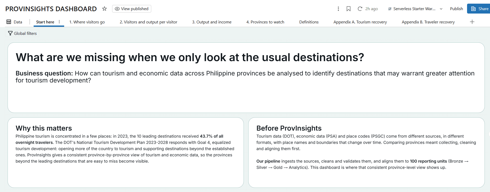

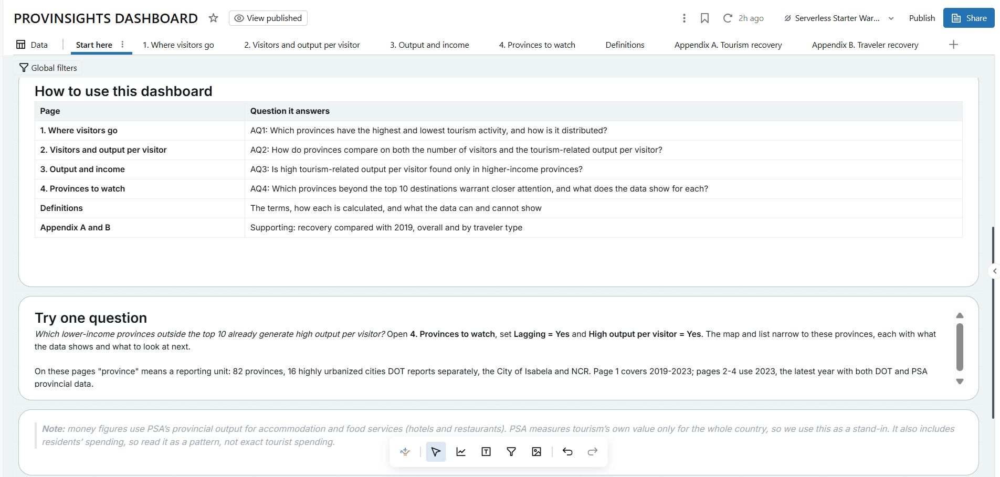

## 1. Where visitors go (AQ1)

*Which provinces have the highest and lowest tourism activity, and how is it distributed?*

| Check | Expected | Shown |
| --- | --: | --: |
| Total overnight travelers, 2023 (93 provinces) | 54,368,299 | 54.4M |
| Share to the leading destinations, 2019 / 2021 / 2023 | 38.1% / 48.5% / 43.7% | same (trend chart) |
| Share to the 10 leading destinations, 2023 | 43.7% | 43.7% |
| Provinces reported by DOT, 2023 | 93 | 93 |
| Leading destinations (2019–2023 average) | 10, NCR first | 10, NCR first |

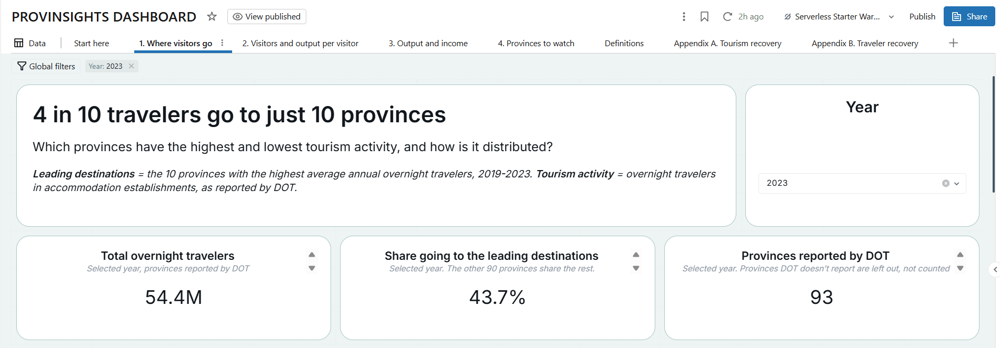

The share to the leading destinations was 38.1% in 2019, peaked at 48.5% in 2021 and was 43.7% in 2023. 2020 and 2021 are labelled as COVID-19 years. This chart ignores the Year filter.

**Why 54.4M and not DOT's 55.3M.** DOT's 2023 grand total is 55,329,974 (`data-quality-rules.md`, section 6.3). The dashboard sums the 93 provinces, 54,368,299. The difference, 961,675, is the Subic Bay Freeport Zone, which has no single PSGC unit and is kept out of the provinces (DL-015). It is still counted when Silver reconciles to DOT's grand total (DQ-DOT-15). Cotabato City (DL-016) has no 2023 count, so it adds nothing in 2023.

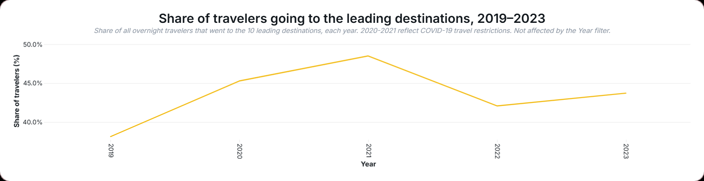

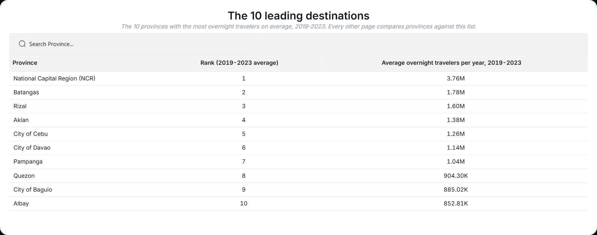

The busiest/quietest chart ranks the *selected year* (2023), so its top 10 can differ from the leading destinations, which use the 2019–2023 average (e.g. Camarines Sur and Cavite are in the 2023 top 10; Quezon and Albay are not).

| Busiest and quietest, 2023 | Travelers per 1,000 residents, 2023 |
| --- | --- |
| 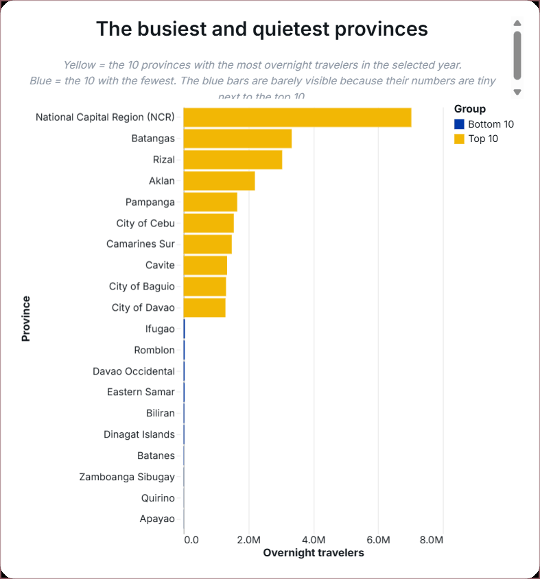 | 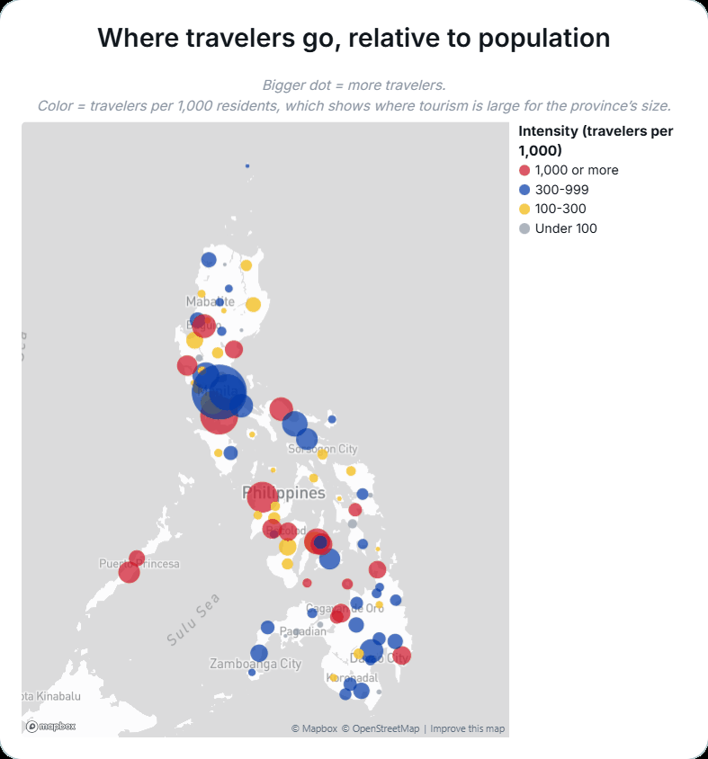 |

## 2. Visitors and output per visitor (AQ2)

*How do provinces compare on both the number of visitors and the tourism-related output per visitor?*

| Check | Expected | Shown |
| --- | --: | --: |
| Established | 16 | 16 |
| Busy but low-output | 21 | 21 |
| Small but high-output | 25 | 25 |
| Limited activity | 21 | 21 |
| Median travelers / output per visitor | 279,150 / ₱8,652 | 279k / ₱8,652 |
| Bataan vs Southern Leyte | ~220k each; ₱28,178 vs ₱1,688 | same |

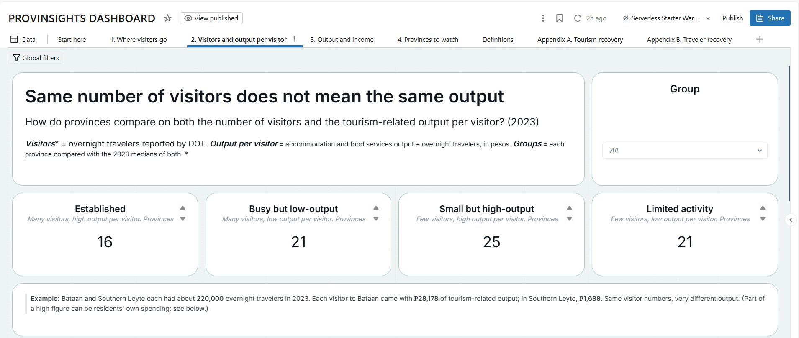

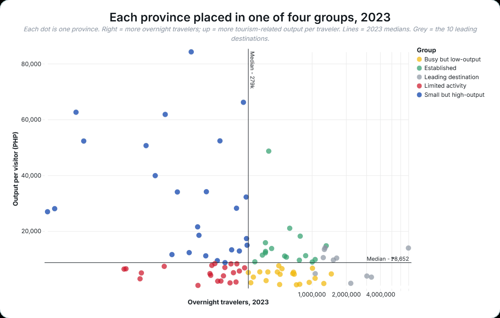

The 10 leading destinations are shown in grey (6 Established, 4 Busy but low-output) and are not counted in the four groups.

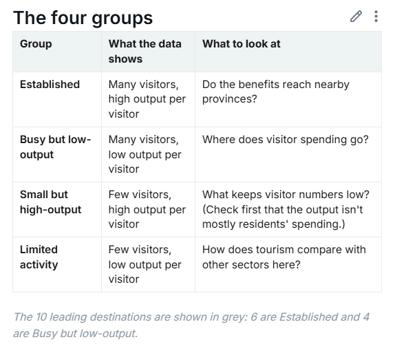

## 3. Output and income (AQ3)

*Is high tourism-related output per visitor found only in higher-income provinces?*

| Check | Expected | Shown |
| --- | --: | --: |
| Lagging provinces with high output per visitor | 14 of 43 | 14 of 43 |
| Higher-income provinces with high output per visitor | 33 of 50 | 33 |
| Correlation, income vs output per visitor (Pearson, 93 provinces incl. the leading destinations) | 0.19 | 0.19 |
| Lagging threshold (median 2023 GDP per capita, all 100 provinces, DL-035) | ₱140,165 | ₱140k |

**How the counts add up.** The lagging threshold is the median 2023 GDP per capita of all 100 provinces (DL-035), so 50 are lagging and 50 are not. Seven lagging provinces have no 2023 DOT count (Abra, Sulu and the five BARMM provinces: Basilan, Lanao del Sur, Maguindanao del Norte, Maguindanao del Sur, Tawi-Tawi), so 43 lagging and 50 higher-income provinces have output per visitor (43 + 50 = 93). Of these, 14 + 33 = 47 are at or above the output-per-visitor median. A median taken over only the 93 provinces would be ₱148,800 and give 46 lagging provinces. The correlation is Pearson's r between 2023 GDP per capita and output per visitor over the same 93 provinces (Spearman's rank correlation is 0.35); both are weak.

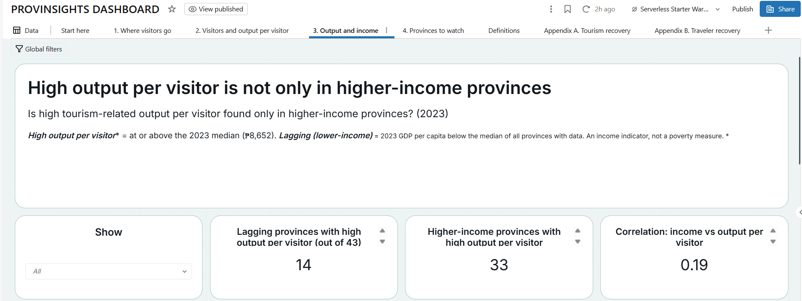

| Income vs output per visitor | Median output per visitor by income group |
| --- | --- |
| 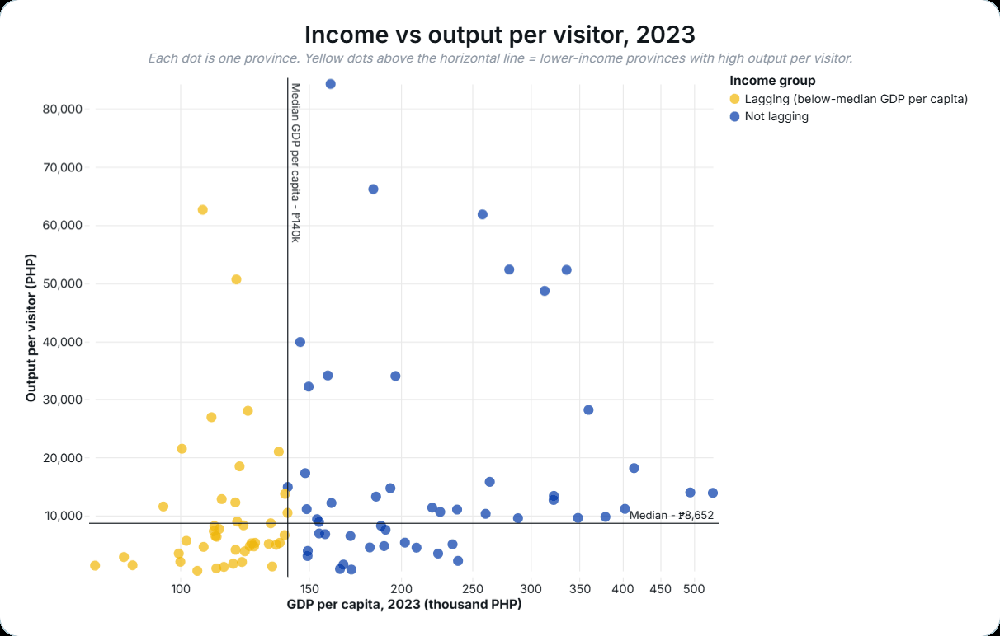 | 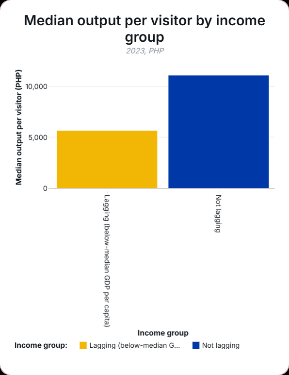 |

The table lists all 43 lagging provinces (25 + 18 rows over two pages). The 14 "Yes" rows include Quezon, a leading destination; without it, 13 remain, which is the AQ4 headline. Three have a small base (under 10,000 travelers): Zamboanga Sibugay, Quirino and Apayao. Leyte sits exactly at the median (₱8,652) and counts as high ("at or above").

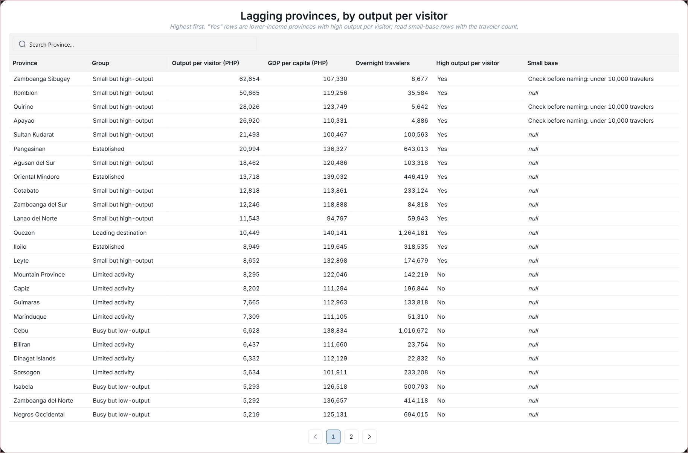

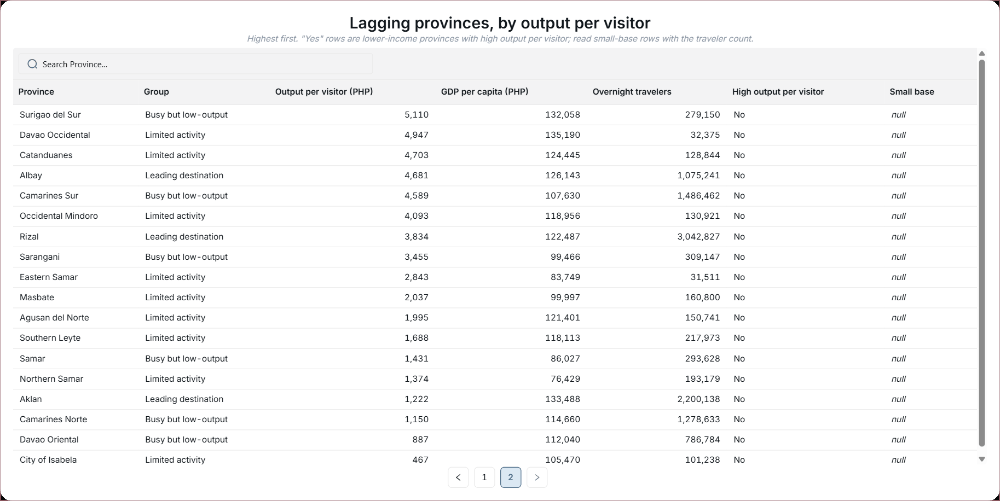

## 4. Provinces to watch (AQ4)

*Which provinces beyond the top 10 destinations warrant closer attention, and what does the data show for each?*

| Check | Expected | Shown |
| --- | --: | --: |
| Priority provinces shown | 83 | 83 |
| Lagging, with high output per visitor | 13 | 13 |
| List order (DL-037) | Busy but low-output (21), Small but high-output (25), Limited activity (21), Established (16); lagging first, then most visitors | same |

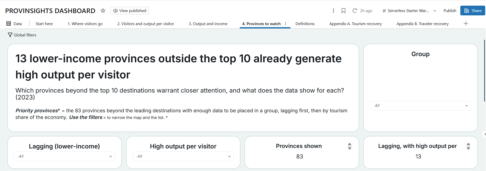

Each row shows **what the data shows** and **what to look at**, not an action or agency. The list starts with Busy but low-output provinces, lagging first (Camarines Sur, Camarines Norte, Cebu…), and ends with the Established provinces, which show no gap on these two measures but stay in the list so the 13 matches page 3 (DL-037).

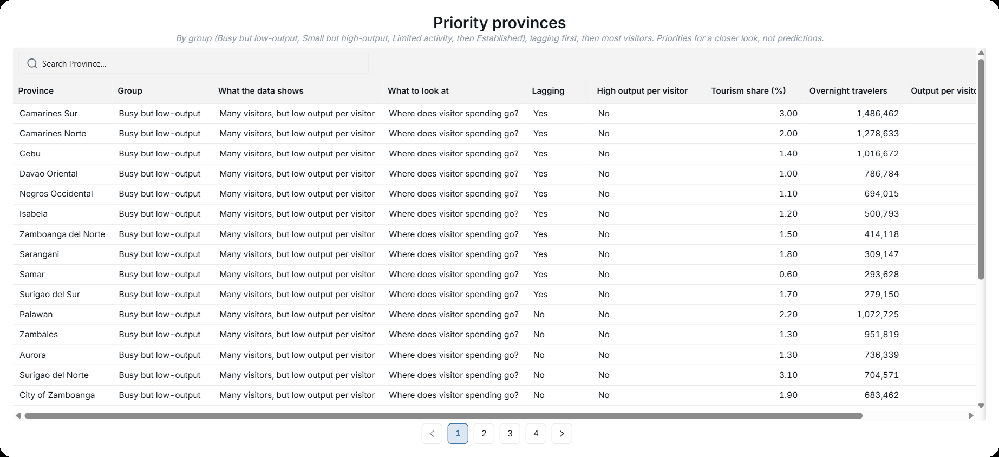

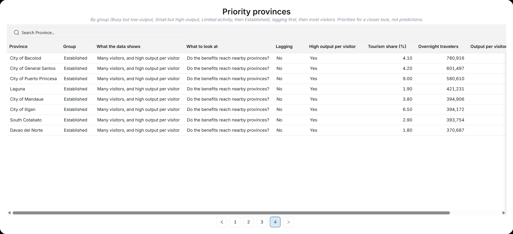

| All groups | Group legend set to Small but high-output |
| --- | --- |
| 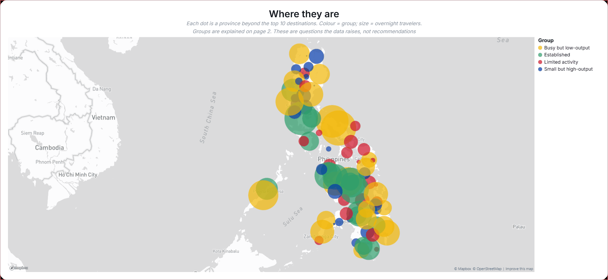 | 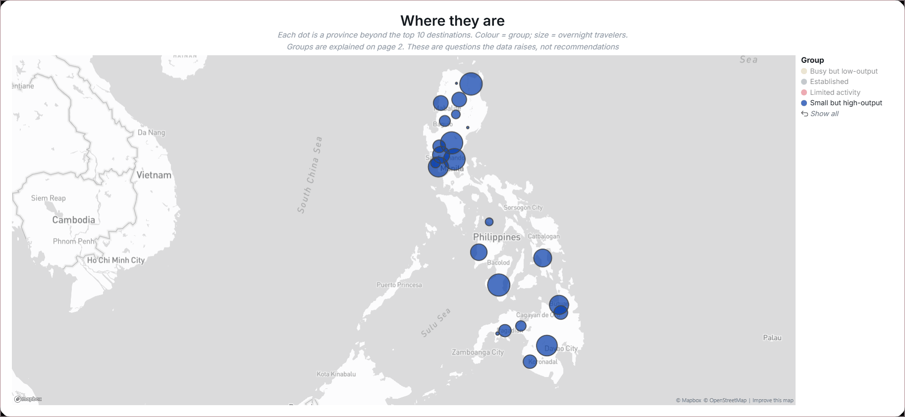 |

## Definitions

Terms, how each is computed, the A&F proxy note, missing-data rules and what is out of scope.

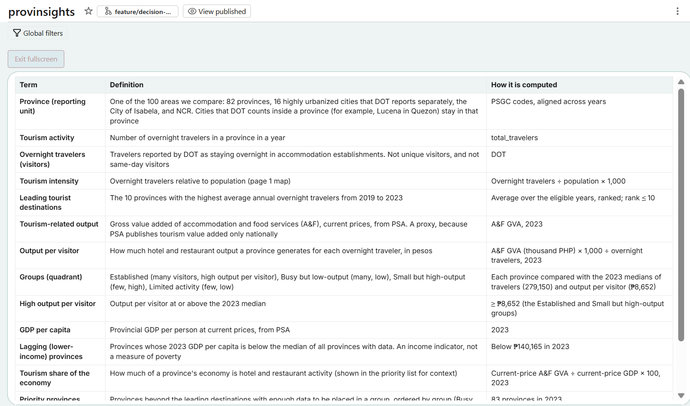

The Priority provinces row gives the AQ4 order, and Tourism share of the economy is shown for context only.

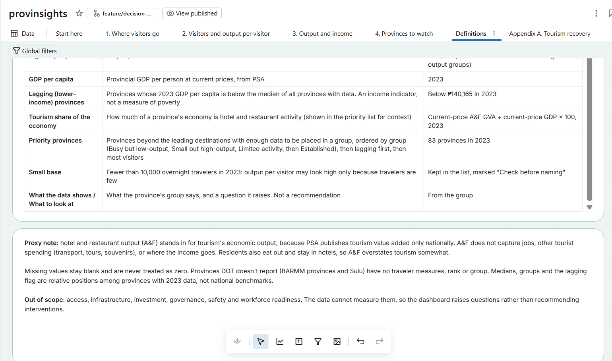

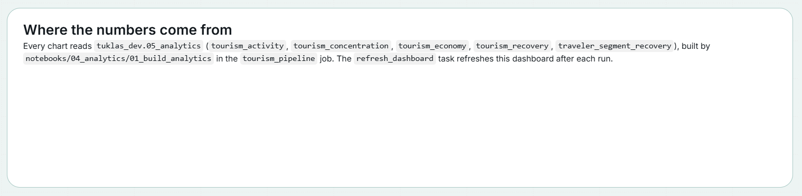

## Limitations

- Output per visitor uses accommodation and food services (A&F) output, which includes residents' spending; read it as a pattern, not exact tourist spending. Provinces under 10,000 travelers are marked "Check before naming".
- Medians, groups and the lagging flag are relative positions among provinces with 2023 data, not national benchmarks.
- The page 2 median lines and the headline numbers are typed text; re-check them after a data change.
