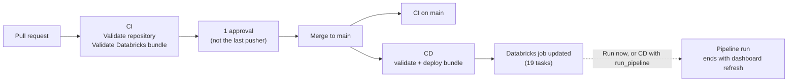
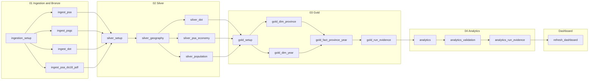
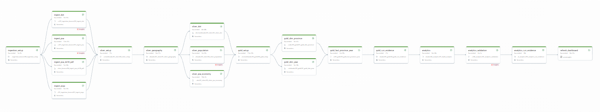
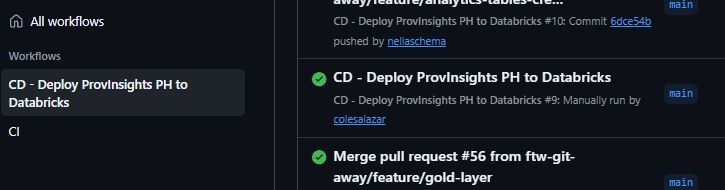

# Pipeline and CI/CD Evidence

This document shows how the ProvInsights pipeline is orchestrated, tested and deployed, and links to runs that prove it works. For how to operate it, see the [runbook](runbook.md). For the platform overview, see [architecture.md](architecture.md).

## Contents

1. [What runs automatically](#1-what-runs-automatically)
2. [Databricks job: `tourism_pipeline`](#2-databricks-job-tourism_pipeline)
3. [CI workflow: `ci.yml`](#3-ci-workflow-ciyml)
4. [CD workflow: `deploy.yml`](#4-cd-workflow-deployyml)
5. [Configuration and secrets](#5-configuration-and-secrets)
6. [Dependencies](#6-dependencies)
7. [Run evidence](#7-run-evidence)

---

## 1. What runs automatically

| Event | What runs | Manual step needed |
| --- | --- | --- |
| Push to a work branch, or a pull request to `main` | CI: **Validate repository** and **Validate Databricks bundle** | None |
| Merge to `main` (pipeline files changed) | CI on `main`, plus CD: **Validate and deploy Databricks bundle** | None |
| Pipeline run | Databricks job `tourism_pipeline` (19 tasks) | Start it with **Run now**, or run CD manually with **run_pipeline** ticked |

On every merge, 3 GitHub Actions jobs run with no manual steps. Deploying updates the Databricks job but does not run it, so a run is always a deliberate choice: each run rewrites the shared `tuklas_dev` tables, and the team runs it sparingly to save compute.

`main` is protected: both CI checks are **required**, the branch must be up to date with `main`, one approval from someone other than the last pusher is needed, approvals are dismissed when new commits change the merge base, and force pushes are blocked.

## 2. Databricks job: `tourism_pipeline`

Defined in [`resources/jobs/tourism_pipeline.yml`](../resources/jobs/tourism_pipeline.yml) and deployed by the bundle in [`databricks.yml`](../databricks.yml).

### Job settings

| Setting | Value | Why |
| --- | --- | --- |
| Tasks | 19 (18 notebook tasks, 1 dashboard task) | One task per notebook, plus the dashboard refresh |
| Compute | Serverless | No clusters to manage |
| `max_concurrent_runs` | 1 | Two runs never write the same tables at once |
| `timeout_seconds` (job) | 10800 (3 h) | Stops a stuck run |
| Failure email | `${var.alert_email}` | Supplied by GitHub (`DATABRICKS_ALERT_EMAIL`) |
| Skipped / cancelled runs | No alert | Avoids noise from manual cancels |

### Task graph

### Tasks, dependencies and limits

| # | Task | Type | Depends on | Timeout (s) | Retries |
| --- | --- | --- | --- | --- | --- |
| 1 | `ingestion_setup` | Notebook | — | 1800 | — |
| 2 | `ingest_psa` | Notebook | `ingestion_setup` | 900 | 2, 30 s apart, also on timeout |
| 3 | `ingest_psgc` | Notebook | `ingestion_setup` | 900 | 2, 30 s apart, also on timeout |
| 4 | `ingest_dot` | Notebook | `ingestion_setup` | 900 | 2, 30 s apart, also on timeout |
| 5 | `ingest_psa_ds18_pdf` | Notebook | `ingestion_setup` | 900 | 2, 30 s apart, also on timeout |
| 6 | `silver_setup` | Notebook | all 4 `ingest_*` tasks | 1800 | — |
| 7 | `silver_geography` | Notebook | `silver_setup` | 1800 | — |
| 8 | `silver_dot` | Notebook | `silver_geography` | 1800 | — |
| 9 | `silver_psa_economy` | Notebook | `silver_geography` | 1800 | — |
| 10 | `silver_population` | Notebook | `silver_geography` | 1800 | — |
| 11 | `gold_setup` | Notebook | `silver_dot`, `silver_psa_economy`, `silver_population` | 1800 | — |
| 12 | `gold_dim_province` | Notebook | `gold_setup` | 2700 | — |
| 13 | `gold_dim_year` | Notebook | `gold_setup` | 2700 | — |
| 14 | `gold_fact_province_year` | Notebook | `gold_dim_province`, `gold_dim_year` | 1800 | — |
| 15 | `gold_run_evidence` | Notebook | `gold_fact_province_year` | 1800 | — |
| 16 | `analytics` | Notebook | `gold_run_evidence` | 2100 | — |
| 17 | `analytics_validation` | Notebook | `analytics` | 900 | — |
| 18 | `analytics_run_evidence` | Notebook | `analytics_validation` | 1800 | — |
| 19 | `refresh_dashboard` | Dashboard | `analytics_run_evidence` | 1800 | — |

### Design choices

- **Layers start with a setup task.** Each setup task waits for the whole previous layer, so every other task depends only on the step directly before it. Tasks in the same step run in parallel.
- **A failure stops everything downstream.** Every task uses the default `run_if: ALL_SUCCESS`. A failed `BLOCK` data-quality check fails its task, and every later task is marked *Upstream failed*, so bad data never reaches the next layer or the dashboard.
- **Retries only where they help.** Only ingestion tasks call external sources (Google Drive), so only they retry. A retry would not fix a failed data-quality check.
- **Timeouts are explained.** Analytics limits are about 3× the longest observed run. Setup, run-evidence and dashboard tasks allow 1800 s for serverless start-up waits. Gold dimensions keep 2700 s because they start right after Silver and may wait for compute.
- **The dashboard is refreshed, not redeployed.** `refresh_dashboard` refreshes the shared dashboard by `${var.dashboard_id}` on `${var.warehouse_id}`. The team edits the dashboard in Databricks, so deploys never overwrite it.

These rules are enforced by the unit tests in [`tests/unit/test_job_definition.py`](../tests/unit/test_job_definition.py) (see section 3).

## 3. CI workflow: `ci.yml`

[`.github/workflows/ci.yml`](../.github/workflows/ci.yml), shown in GitHub as **CI**.

**Triggers:** push to `main`, `feature/**`, `chore/**`, `docs/**`, `fix/**`, `test/**` or `ci/**`; pull requests to `main`; manual run.

**Permissions:** `contents: read` only.

### Job 1: Validate repository (required check)

| Step | What it checks |
| --- | --- |
| Check out repository | `actions/checkout`, pinned to a commit SHA |
| Set up Python | Python 3.12 |
| Install test dependencies | `tests/requirements.txt` (pinned versions) |
| Check required files and directories | `README.md`, `docs`, `notebooks`, `resources`, `tests` exist, and `README.md` is not empty |
| Check notebooks directory contents | `notebooks/` holds only `.ipynb` files and `README.md` |
| Run unit tests | 27+ `unittest` tests in `tests/unit/` (below) |

| Test file | What it checks |
| --- | --- |
| `test_job_definition.py` | Unique task keys; every notebook path exists; every `depends_on` points to a real task; no cycles; each layer starts only after the whole previous layer; every task has a timeout within the job timeout; retries only on `ingest_*`; failure email and one run at a time; the dashboard task uses `${var.dashboard_id}` and `${var.warehouse_id}`; the Tasks table and run-order diagram in `resources/README.md` match the job |
| `test_notebook_python.py` | Notebooks are valid JSON with a markdown cell; every Python cell compiles; `CATALOG` is `tuklas_dev`; no tokens or passwords; every `dq(...)` severity is `BLOCK`, `REVIEW` or `LOG` |
| `test_notebook_sql.py` | Every `%sql` cell and `spark.sql("...")` literal parses as Databricks SQL (`sqlglot`) |
| `test_seeds.py` | The 4 seed CSVs: row counts, unique keys, row roles, 10-digit PSGC codes, known reporting units, coordinates inside the Philippines, ordered validity years |
| `test_docs_alignment.py` | Every Silver `dq("ID")` check is documented in `docs/data-quality-rules.md`, and every documented Silver check is implemented |

These are static tests: they need only the repository files, not Databricks. Data correctness is checked at run time by the data-quality checks inside the notebooks.

### Job 2: Validate Databricks bundle (required check)

| Step | What it does |
| --- | --- |
| Check out repository | Pinned `actions/checkout` |
| Check required GitHub configuration | Fails with a clear message if `DATABRICKS_HOST`, `DATABRICKS_TOKEN` or `DATABRICKS_ALERT_EMAIL` is missing |
| Install Databricks CLI | Version 1.19.0 (pinned) |
| Validate bundle | `databricks bundle validate -t dev`, so a wrong notebook path or invalid YAML fails the PR instead of the deploy |

It uses the **`ci-validate`** environment with a separate, low-privilege token, because pull requests can change workflow files. The deploy token stays in `development`, which only `main` can use. The job is skipped for pull requests from forks, which cannot read environment secrets.

## 4. CD workflow: `deploy.yml`

[`.github/workflows/deploy.yml`](../.github/workflows/deploy.yml), shown in GitHub as **CD - Deploy ProvInsights PH to Databricks**.

**Triggers:**

- Push to `main` that changes `databricks.yml`, `resources/**`, `notebooks/**`, `tests/**`, `dashboard/**` or the workflow itself. Docs-only merges don't deploy.
- Manual run (**Run workflow**), with a `run_pipeline` option (default off) to start the job after deploying.

**Safety:** `contents: read` permissions; `concurrency` group `provinsights-databricks-dev` with `cancel-in-progress: false`, so two deploys never overlap and a running deploy is never cut off.

### Job: Validate and deploy Databricks bundle

Uses the **`development`** environment (restricted to `main`).

| Step | What it does |
| --- | --- |
| Check out repository | Pinned `actions/checkout` |
| Check required GitHub configuration | Fails clearly if a required value is missing |
| Install Databricks CLI | Version 1.19.0 (pinned) |
| Validate bundle | `databricks bundle validate -t dev` |
| Deploy bundle | `databricks bundle deploy -t dev`: uploads the notebooks and seeds and updates the job |
| Show deployed Databricks resources | `databricks bundle summary -t dev`, also written to the run's summary page |
| Run end-to-end pipeline | Only on a manual run with `run_pipeline` ticked: `databricks bundle run -t dev tourism_pipeline` |

## 5. Configuration and secrets

No workspace URL, token or email address is stored in the repository.

| Name | Kind | Where | Used by |
| --- | --- | --- | --- |
| `DATABRICKS_HOST` | Environment variable | GitHub environments `ci-validate` and `development` | CI bundle check, CD |
| `DATABRICKS_TOKEN` | Environment secret | `ci-validate` (validate-only token), `development` (deploy token) | CI bundle check, CD |
| `DATABRICKS_ALERT_EMAIL` | Environment variable | Both environments | Passed to the bundle as `alert_email` |
| `warehouse_id` | Bundle variable with default | `databricks.yml` | `refresh_dashboard` |
| `dashboard_id` | Bundle variable with default | `databricks.yml` | `refresh_dashboard` |
| `capstone_gdrive` | Unity Catalog connection | Databricks | Ingestion notebooks read Google Drive without keys |

Both Databricks tokens expire, so a renewal is scheduled before the first expiry.

## 6. Dependencies

| Dependency | Version or setting | Where it is set |
| --- | --- | --- |
| Databricks CLI | 1.19.0 | `ci.yml`, `deploy.yml` |
| GitHub Actions | `actions/checkout` and `databricks/setup-cli` pinned to commit SHAs; `actions/setup-python@v7` | `ci.yml`, `deploy.yml` |
| Python (CI) | 3.12 | `ci.yml` |
| Test libraries | `sqlglot`, `pyyaml` (pinned) | `tests/requirements.txt` |
| Notebook libraries | `openpyxl`, `pdfplumber` (`%pip install` at run time) | Ingestion notebooks |
| Databricks platform | Unity Catalog, Delta Lake, serverless jobs compute | Workspace |
| Catalog | `tuklas_dev` | `CATALOG` in every notebook |
| SQL warehouse | Serverless Starter Warehouse | `warehouse_id` in `databricks.yml` |
| Seed files | 4 reviewed CSVs | `resources/seeds/` |

## 7. Run evidence

### Full pipeline run

| Item | Result |
| --- | --- |
| Job run | [300208709071832](https://dbc-5e346557-03d4.cloud.databricks.com/jobs/680308985921105/runs/300208709071832): every task succeeded |
| Data quality | Every `BLOCK` check passed in Silver, Gold and Analytics. One `REVIEW` flag (`DQ-DOT-11`, 3 unit-years with a year-over-year change above 5×), documented and non-blocking |
| Run logs | Latest run of every Silver, Gold and Analytics notebook is `SUCCESS`; `02_silver_dot` is `SUCCESS_WITH_REVIEW`, matching `DQ-DOT-11` |
| Tables written by the run | `04_gold.fact_province_year` version 137 (`CREATE OR REPLACE TABLE AS SELECT`) shows `jobRunId` 300208709071832 in its Delta history |

<!-- Add the screenshot as docs/images/job-run-graph.png, or delete this line. -->

### Changes verified after that run

To save compute, later changes were verified individually instead of with a second full run:

| Change | Verified by |
| --- | --- |
| Notebook folder rename | `bundle validate` and the CI test "every notebook path exists" |
| `refresh_dashboard` task | `--only refresh_dashboard` runs on the shared dashboard succeeded (`TERMINATED SUCCESS`) |
| Analytics updates | Reruns of all three Analytics notebooks on 21 Oct, recorded in [analytics-run-evidence.md](analytics-run-evidence.md) |

### CI/CD runs

Every merged pull request passed both required CI checks, and every merge that changed pipeline files was deployed by CD. See the repository's **Actions** tab.

<!-- Add the screenshot as docs/images/github-actions-runs.png, or delete this line. -->

Layer-level evidence: [Gold](gold-run-evidence.md) and [Analytics](analytics-run-evidence.md).
